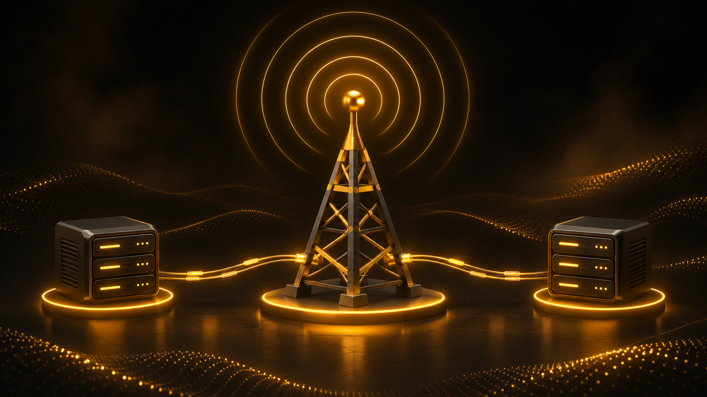

<div align="center">


</div>

> **Self-hosted VPN & proxy orchestration dashboard.** Your VPS nodes, your rules — no cloud provider or middlemen.

Hoplyra is not just a panel for a single VPN. It is a **multi-hop chain builder and node orchestrator**: compose routes from different protocols across your own servers, deploy standalone proxies or **Hysteria Realms** relay brokers, monitor node reachability, and deliver ready-to-import client configs from a single **Ink Amber** web UI.

---

## 🛡 Protocols

| | ID | Protocol | Transport / Port | Highlights |
|:-:|---|----------|------------------|------------|
|  | `awg` | **AmneziaWG 3.1** | `55424/udp` | Containerized; **Default** & **Stealth** modes, CPS mimicry (`I1–I5`), `HPK` |
|  | `wg` | **WireGuard** | `51820/udp` | Containerized fast kernel/userspace tunnel, multi-peer, QR configs |
|  | `openvpn` | **OpenVPN** | `1194/udp` or `tcp` | Managed PKI, UDP/TCP profiles, multi-client `.ovpn` exports |
|  | `xray` | **Xray VLESS** | `443/tcp` | TLS / **REALITY**, ClientHello fragmentation, Chrome fingerprint, multi-peer URIs |
|  | `hysteria2` | **Hysteria 2** | `443/udp` | QUIC congestion control, port hopping, cert pinning, multi-peer & QR |
|  | `shadowquic` | **ShadowQUIC** | `443/udp` | **0-RTT** QUIC proxy with **JLS** TLS SNI camouflage and zero cert overhead |
|  | `tor` | **Tor (SOCKS)** | `9050/tcp` | Relay hop or rotating-IP exit inside multi-hop chains |

### 🧅 AmneziaWG 3.1 — Default and Stealth

Hoplyra speaks full **AmneziaWG 3.1** in an isolated container (`hoplyra-awg:1`) with two one-click modes:

- **Default** — plain AWG 3.1 without obfuscation when WireGuard is unfiltered
- **Stealth** — automatic obfuscation profile: junk packets (`Jc/Jmin/Jmax`), packet-size shifts (`S1–S4`), magic headers (`H1–H4`), and CPS mimicry chains (`I1–I5`) with **QUIC / TLS / DNS / SIP / STUN** presets plus `HeaderProtectionKey`, `ContentPaddingAddition`, `RandomTrailers`, and `DisableCookies`

---

## 🔗 Multi-Chains

<div align="center">


</div>

| | Capability | How it works |
|:-:|------------|--------------|
|  | **Cross-protocol routing** | Combine **AWG, WireGuard, OpenVPN, Xray, Hysteria 2, ShadowQUIC, and Tor** across separate VPS nodes into a single route |
|  | **Side-by-side isolation** | Every deployment gets its own **container, interface, port, and subnet** — multiple configs coexist on the same server |
|  | **Bypass RU split tunneling** | Client-side exact 32-bit inverted IPv4 `AllowedIPs` routing so Russian domestic subnets go direct while everything else uses the tunnel |
|  | **Resilient live deploy** | Background **multi-process SQLite leases** with heartbeats, crash recovery, and **real-time SSE deploy log drawer** with automatic secret redaction |

**Common patterns:** `AWG → Tor → Xray`, `Xray → Tor → Xray`, `Hysteria 2 → Tor`, `ShadowQUIC → Tor`, `OpenVPN → AWG` — clients receive **one entry config** (with multi-peer management and live per-config traffic stats on the **Configs** page).

---

## 🌐 Hysteria Realms

<div align="center">



</div>

The **Hysteria Realms** tab orchestrates high-speed QUIC tunnel relays via a broker + agent architecture (`hoplyra-realm-server:1`):

| | Feature | Purpose |
|:-:|---------|---------|
|  | **Realm Broker** | Central control broker coordinating authenticated entry/exit relay nodes on your VPS fleet |
|  | **High-speed QUIC transport** | Low-latency UDP/QUIC forwarding resilient to packet loss on mobile and cross-border links |
|  | **Direct peer & chain tunnels** | Attach local SOCKS5/VPN entrypoints or chain downstream servers with health tracking and automatic teardown |

---

## 🧦 Proxies (VPN-Attached & Standalone)

<div align="center">


</div>

The **Proxy** tab covers both **VPN/chain-attached SOCKS5** sidecars and **standalone containerized proxies** deployable directly onto any VPS with Docker or Podman:

| | Type | Engine | Highlights |
|:-:|------|--------|------------|
|  | **Attached SOCKS5** | `hoplyra-socks:1` (`3proxy`) | Toggle on/off **without redeploy** on any active VPN or multi-hop chain (`entry → … → exit`) |
|  | **Standalone SOCKS5** | `hoplyra-gost:1` (`gost`) | Auto-allocated port (`1080` default), optional auth, QR & `socks5://` share URI |
|  | **Secure HTTPS** | `hoplyra-gost:1` (`gost`) | HTTP/HTTPS `CONNECT` proxy over TLS (`8443` default), self-signed cert bundle, `https://` client URI |
|  | **MTProto Fake-TLS** | `hoplyra-mtg:2` (`mtg`) | Telegram proxy (`8443` default) with `ee…` **Fake-TLS** SNI camouflage and `tg://proxy` / `t.me/proxy` QR & links |
|  | **Shadowsocks** | `hoplyra-gost:1` (`gost`) | AEAD ciphers (`AEAD_CHACHA20_POLY1305`, `AEAD_AES_256_GCM`, `AEAD_AES_128_GCM`), `ss://` SIP002 URI & QR |

---

## 📊 Status & Censor Check

<div align="center">


</div>

| | Tool | Capabilities |
|:-:|------|--------------|
|  | **Live Server Status** | Real-time SSH polling (~1s) for **CPU, RAM, disk, load average, uptime, network throughput, latency**, and running containers without head-of-line blocking |
|  | **Censor Check** | Active reachability & DPI/blocking probe from Russian network vantage points before you deploy configs onto a node |
|  | **Flexible SSH Auth** | Connect VPS nodes via **SSH private keys, system ssh-agent, or encrypted passwords** stored safely in SQLite |

---

## 🔐 Security, Backups & Updates

<div align="center">


</div>

| | Feature | Details |
|:-:|---------|---------|
|  | **Panel Auth & Auto-HTTPS** | Local admin auth with **HTTP-only** secure session cookies, brute-force rate limiting (`Retry-After`), encrypted VPS credentials, and automatic TLS certs (`scripts/generate-ssl.sh`) |
|  | **Hardened 2FA (TOTP)** | Built-in RFC 6238 **TOTP authenticator** with offline QR code generation and single-use backup recovery codes |
|  | **Encrypted Backups** | Export and restore full Hoplyra state (servers, configs, chains, keys, proxies) from **Settings** |
|  | **1-Click System Update** | Check GitHub releases and upgrade Hoplyra in place from the **Settings** tab with **hardened automatic rollback** on failure |

---

## ⚙️ Installation

Hoplyra is a **self-hosted Linux server application** serving both the API and web UI on a single HTTPS port (`8787`).

**Dependencies** (Debian / Ubuntu example):

```bash
sudo apt install make python3-venv podman podman-compose
```

*(Docker + Docker Compose are also supported on managed VPS nodes.)*

**Install & Start:**

```bash
git clone https://github.com/Linchevatel/Hoplyra.git
cd Hoplyra
make install
```

Open **https://YOUR_SERVER_IP:8787** (locally: **https://127.0.0.1:8787**), sign in with **`admin` / `admin`**, then immediately **change your password** and enable **2FA** in **Settings**.

**Container images:**

| Image | Purpose |
|-------|---------|
| `hoplyra-gateway:1` | Xray + Tor + iptables gateway for AWG/WG/OpenVPN chains |
| `hoplyra-tor:1` | Tor relay & rotating-exit sidecar |
| `hoplyra-xray:1` | Xray VLESS + TLS / REALITY relay & exit |
| `hoplyra-wg:2` | WireGuard containerized server |
| `hoplyra-awg:1` | AmneziaWG 3.1 containerized server |
| `hoplyra-openvpn:5` | OpenVPN + PKI server |
| `hoplyra-hysteria2:1` | Hysteria 2 QUIC server |
| `hoplyra-shadowquic:1` | ShadowQUIC 0-RTT QUIC + JLS server |
| `hoplyra-realm-server:1` | Hysteria Realms broker & tunnel agent |
| `hoplyra-socks:1` | `3proxy` sidecar for VPN/chain-attached SOCKS5 |
| `hoplyra-gost:1` | `gost` server for standalone SOCKS5, Secure HTTPS, and Shadowsocks |
| `hoplyra-mtg:2` | `mtg` v2 server for MTProto Fake-TLS proxies |

---

## 💛 Support the project

| | Network | Address |
|:-:|---------|---------|
|  | **Bitcoin** | `bc1q0u4pwuqxg7kt5y4p84lc8zzcawhzr3auzw005z` |
|  | **Ethereum** | `0xD3002c0967a8D28FDF67c2Df8488006e965B9a6A` |
|  | **TRON (TRC-20)** | `TYUkmupkzCGzkio77Db7PKEDu4JN8JD1eb` |
|  | **TRON** | `TX7yRGo5xT2Mj5NBVhu7bdv58jmStHFuGZ` |

---

## 📄 License

MIT
